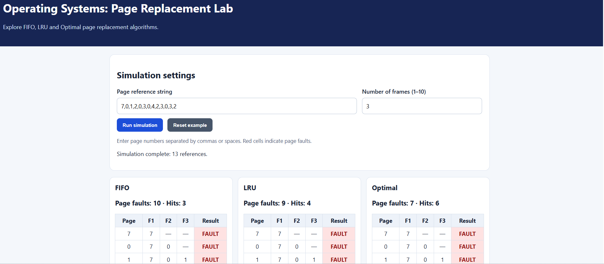

# CSE Teaching Resources 🎓

**Practical learning resources, programming examples, and interactive demonstrations for Computer Science and Engineering.**

Welcome to my CSE teaching repository! This project brings together educational materials that help students connect theoretical concepts with working implementations.

🌐 **Website:** [gokulakrishnan.co.in](https://gokulakrishnan.co.in/)  
👨‍🏫 **Maintainer:** Dr. Gokulakrishnan S

---

## 🚀 Featured Demonstration

### Operating Systems — Page Replacement Visualizer

Explore how operating systems manage memory when a requested page is not available in physical memory.

**[▶ Launch the Interactive Visualizer](https://gokulakrishnaans.github.io/CSE-teaching-resources/)**

Compare these algorithms:

| Algorithm | Principle |
|---|---|
| FIFO | Replaces the page that entered memory first |
| LRU | Replaces the page that was used least recently |
| Optimal | Replaces the page whose next use is farthest in the future |

The visualizer lets you enter a page-reference string, choose the number of frames, and compare page faults and hits.

**Source code:** [View this repository](https://github.com/gokulakrishnaans/CSE-teaching-resources)

---
### 📸 Visual Preview



*Interactive demonstration of FIFO, LRU, and Optimal page replacement algorithms.*

[▶ Launch the live visualizer](https://gokulakrishnaans.github.io/CSE-teaching-resources/)
## 👨‍🏫 About

I am an Associate Professor in Computer Science and Engineering, interested in computer science education, software development, artificial intelligence, and practical learning.

My goal is to make technical concepts easier to understand through clear explanations, executable examples, and interactive learning tools.

## 📚 Subject Areas

- **Operating Systems:** Process scheduling, memory management, page replacement, deadlocks, and file systems
- **Data Structures and Algorithms:** Fundamental data structures, algorithm design, and complexity analysis
- **Database Management Systems:** SQL, relational databases, normalization, and transactions
- **Computer Networks:** Network protocols, addressing, and network programming
- **Artificial Intelligence:** Machine learning fundamentals and Generative AI applications

## 🗂️ Repository Structure

```text
CSE-teaching-resources/
├── Operating-Systems/
│   ├── README.md
│   ├── page_replacement.py
│   ├── sample_output.txt
│   └── page-replacement-visualizer.html
├── Data-Structures/
├── DBMS/
├── Computer-Networks/
└── AI-ML/
```

*The Operating Systems files above are part of the current project. The other subject folders are planned areas; add them as the corresponding resources become available.*

## 💻 Getting Started

### Use the interactive visualizer

1. Open the [live page-replacement visualizer](https://gokulakrishnaans.github.io/CSE-teaching-resources/).
2. Enter a page-reference string, such as `7,0,1,2,0,3,0,4,2,3,0,3,2`.
3. Select the number of memory frames.
4. Compare FIFO, LRU, and Optimal results.

### Run the Python implementation

Requirements: Python 3.

1. Clone the repository:

   ```bash
   git clone https://github.com/gokulakrishnaans/CSE-teaching-resources.git
   ```

2. Open the project directory:

   ```bash
   cd CSE-teaching-resources
   ```

3. Run the implementation:

   ```bash
   python Operating-Systems/page_replacement.py
   ```

## 🎯 Objectives

- Support practical and outcome-based learning.
- Connect theoretical concepts with working implementations.
- Provide examples that students can study, modify, and extend.
- Encourage reproducible experiments and collaborative learning.

## 🛠️ Technologies

Depending on the resource, this repository may use Python, C, Java, SQL, HTML, CSS, JavaScript, and other relevant tools.

## 🤝 Contributions

Suggestions and educational improvements are welcome. Please ensure that contributions are original, properly attributed, and suitable for educational use.

## 📌 Disclaimer

These materials are intended for educational purposes. Students should follow their institution's academic integrity and submission guidelines.

---

**Teaching · Research · Innovation · Lifelong Learning**
